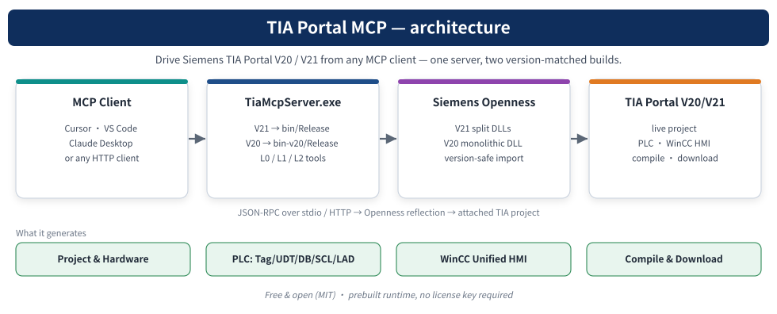

# TIA Portal V17 MCP · 本地扩展派生版

基于 [bulaofen0036-coder/TIA_Portal_Openness_MCP](https://github.com/bulaofen0036-coder/TIA_Portal_Openness_MCP) 的本地扩展，保留原作者2026 MIT。自有增量主要是 V17 软件工具补充与本地集成脚本，**不把上游完整PLC/HMI框架冒称从零原创**。



[静态源码/验证导览](https://yangwei251003.github.io/tia-portal-v17-local/) · [本轮验证](docs/local-validation.md) · [上游历史说明](docs/UPSTREAM_README.md)

## 实际保存的本地增量

- 保留当前 PlcSoftwareV17McpTools 的partial改动与新增LocalTools源码：打开既有梯形图编辑器、只读检查仿真下载接口、严格限定具名测试项目/PLCSIM虚拟接口的下载运行方法。
- 真实stdio MCP初始化/工具列表检查发现65个阶段工具，新增3项均可见；本轮**没有调用这些工程工具**，没有连接TIA、打开项目、PLC下载或RUN操作。
- 集成示例不再在导入/pytest时自动启动TIA；需要明确 --execute 和目标。配置辅助只输出待审阅片段，不修改个人Codex配置。SDK分段下载辅助保留为手动安装代码，不含SDK归档，也未在本轮执行下载。

## 环境与最简源码检查

只阅读/验证源码结构，需要Python3；不会启动TIA或需要设备。

```sh
python scripts/validate_source.py
```

实际服务需要Windows x64、.NET Framework4.8与兼容.NET SDK（本轮使用8.0.425）、相匹配的Siemens Openness开发组件/本机产品环境，以及使用者自己的合法权限。没有附带商业产品、SDK、DLL、exe或厂商手册PDF。编译并不证明产品授权、工程导入或设备下载权限。

```powershell
dotnet build tools/tiaportal-mcp/src/TiaMcpServer/TiaMcpServer.V17.csproj -c Release
```

NuGet按项目精确版本恢复依赖。V17构建是本轮验证范围，V20/V21源码配置保留但未构建。源码对Framework引用的标准Windows路径沿用上游；缺少相应开发包时应先准备官方环境。

编译后可运行真实离线检查，替换下例为自己的输出位置：

```powershell
python scripts/check_offline.py --server-exe tools/tiaportal-mcp/src/TiaMcpServer/bin-v17/Release/net48/TiaMcpServer.exe
python scripts/check_stdio_metadata.py --server-exe tools/tiaportal-mcp/src/TiaMcpServer/bin-v17/Release/net48/TiaMcpServer.exe
```

第一条运行6项自包含HMI XML检查，以及空PLC金样本的失败前置条件检查；第二条仅initialize/tools-list，不调用工程工具。需要运行服务器时，阅读上游文档并自行配置MCP客户端及产品安装位置；Windows UI、项目连接、仿真下载必须单独明确操作目标，不能用本次离线结果作为现场验收。

## 真实结果与尚缺条件

- 本轮V17源码恢复/编译通过：0错误、3条既有nullable警告。复用已有SDK和只读NuGet回退缓存，输出在独立私有工作区。
- 6项离线HMI检查全部通过。stdio初始化通过、65项工具可发现、自定义3项可见，0次工程工具调用。
- PLC Builder所需5份原始金样本未随上游源码提供；原程序直接打开缺失UDT文件会崩溃。现已先报告 blocked/ok=false，退出码2，并保留缺失项，不伪造金样本、也不声称完整PLC Builder验收通过。
- 未验证真实TIA导入、在线读值、硬件接口、仿真下载、RUN、实际PLC与WinCC渲染。源代码有这些能力入口，不等于全部已验证。

## 目录与文档

tools/tiaportal-mcp/src/TiaMcpServer 为完整当前C#源码；templates 为上游PLC/HMI文本模板；tools/tiaportal-mcp/skill 保留上游Skill/示例；integration 为本地适配和手动安装示例；scripts 提供源码/离线检查；site 为静态导览。

原Validate-Bundle.ps1用于带exe/手册的上游发行包，保留其原行为。本源码仓库CI改为validate_source.py，不把缺少二进制的源码包冒称完整发行包。静态Pages不运行TIA或控制器。

根MIT保持原作者；第三方NuGet/Siemens组件保留各自许可，未重新授权或分发。后续优先补齐合法金样本、跨版本兼容与独立工程验收。本项目仍在开发，原件包含安装环境、SDK缓存和私人验证输出，**当前不可本地删除**。更新见 CHANGELOG.local.md。
